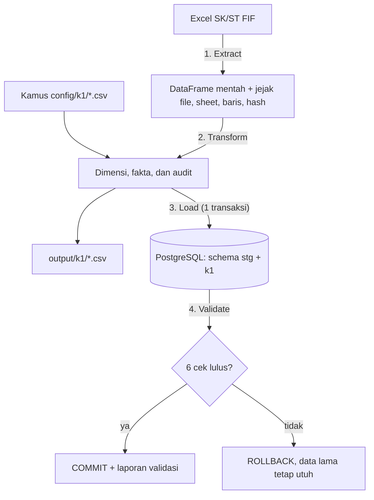
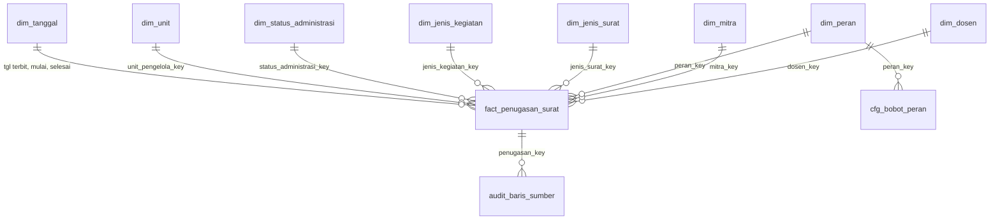

# ETL Pipeline K1: Penugasan Dosen melalui SK dan Surat Tugas

ETL pipeline untuk data warehouse **Sekretariat Pimpinan (Sekpim) Fakultas Informatika**, KPI **K1**:
penugasan dosen melalui Surat Keputusan (SK) dan Surat Tugas (ST). Pipeline ditulis dengan **Python**,
berjalan di luar database, dan memuat data Excel ke **star schema di PostgreSQL**. Hasilnya juga disimpan
sebagai CSV supaya nanti mudah dipindah ke BigQuery.

> Tugas Besar mata kuliah Data Warehouse, Kelompok 1, S1 Sains Data Telkom University.
> Repo ini khusus ETL **K1** (PIC: Rudi Firdaus). ETL K2–K5 dikerjakan anggota kelompok lain di luar repo ini.

| | |
|---|---|
| Sumber | `ST dan SK FIF 2026.xlsx` (sheet *Rincian SK dan ST* dan *Data Dosen*) |
| Target | PostgreSQL 16+ (prototype), rencana BigQuery |
| Hasil | Schema `k1`: 1 tabel fakta, 9 dimensi, 1 tabel audit |
| Hasil uji | 441 baris sumber → 422 fakta, 6 dari 6 cek validasi lulus |

## Daftar isi

1. [Alur pipeline](#alur-pipeline)
2. [Struktur folder](#struktur-folder)
3. [Persiapan](#persiapan)
4. [Menjalankan ETL](#menjalankan-etl)
5. [Hasil](#hasil)
6. [Star schema K1](#star-schema-k1)
7. [Aturan transformasi](#aturan-transformasi)
8. [Validasi](#validasi)
9. [Kamus yang bisa diedit](#kamus-yang-bisa-diedit)
10. [Troubleshooting](#troubleshooting)
11. [Catatan lanjutan](#catatan-lanjutan)

---

## Alur pipeline



| Tahap | Yang dilakukan |
|---|---|
| **1. Extract** | Membaca Excel apa adanya (tipe data tidak diubah), lalu menambah kolom jejak `_file`, `_sheet`, `_row`, `_hash`, `_payload`. |
| **2. Transform** | Membakukan kode dosen, peran, mitra, tanggal, dan kategori kegiatan; menyatukan duplikat dan multi-peran; membentuk surrogate key; mencatat keputusan untuk setiap baris sumber. Tidak butuh database. |
| **3. Load** | Full refresh dalam satu transaksi: baris mentah ke `stg.raw_baris`, lalu dimensi, fakta, dan audit ke schema `k1`. Dijalankan berulang kali hasilnya tetap sama. |
| **4. Validate** | Menjalankan 6 cek penerimaan. Kalau satu saja gagal, semua perubahan run itu di-rollback. |

Menghitung metrik K1A–K1D **bukan** tugas ETL. Metrik dihitung di layer query (SQL view atau Looker Studio)
di atas star schema; contohnya ada di [`sql/99_k1_query_kpi.sql`](sql/99_k1_query_kpi.sql).

---

## Struktur folder

```
Tubes_5_ETL/
├── README.md
├── requirements.txt              library Python yang dibutuhkan
├── .gitignore                    settings.ini, output/, dataset, dan cache tidak ikut di-commit
├── config/
│   ├── settings.example.ini      contoh pengaturan; salin jadi settings.ini
│   └── k1/                       kamus K1 (CSV), bisa diedit tanpa mengubah kode
├── etl/
│   ├── __init__.py               penanda package Python (kosong)
│   ├── run.py                    pintu masuk: python -m etl.run --kpi k1
│   ├── common.py                 fungsi bersama: baca Excel, parse tanggal, koneksi DB, insert
│   └── k1_sk_st.py               semua aturan ETL K1: extract, transform, load, validate
├── sql/
│   ├── 00_staging.sql            schema stg: stg.raw_baris dan stg.etl_log
│   ├── 01_k1_schema.sql          star schema K1: DDL + isi dimensi referensi
│   └── 99_k1_query_kpi.sql       contoh query metrik K1A–K1D
├── templates/                    opsional, tidak dijalankan pipeline K1
│   ├── kx_template.py            pola ETL yang sama untuk KPI lain
│   └── 01_kx_schema_template.sql contoh schema untuk template
└── output/                       dibuat otomatis saat ETL jalan (tidak di-commit)
    └── k1/                       CSV hasil transform + laporan_validasi_k1.md
```

### Fungsi utama di setiap file

| File | Fungsi | Kegunaan |
|---|---|---|
| `etl/run.py` | `main()` | Mengatur urutan extract → transform → load → validate, commit atau rollback, log, dan laporan |
| | `kumpulkan_raw()` | Mengumpulkan semua DataFrame hasil extract untuk disimpan ke staging |
| | `tulis_laporan()` | Menulis `output/k1/laporan_validasi_k1.md` |
| `etl/common.py` | `read_excel_raw()` | Membaca sheet Excel apa adanya + kolom jejak sumber |
| | `clean_text()`, `norm_key()`, `norm_name()`, `slug()` | Merapikan teks, kunci pencocokan kamus, normalisasi nama dosen |
| | `parse_date()`, `date_key()` | Membaca tanggal tanpa menebak; tanggal → key `YYYYMMDD` (0 = tidak diketahui) |
| | `connect()`, `run_sql_file()`, `insert_df()` | Koneksi PostgreSQL, menjalankan DDL, INSERT DataFrame sekaligus |
| | `save_staging()`, `write_csv()` | Menyimpan baris mentah ke `stg.raw_baris`; menulis tabel hasil ke CSV |
| `etl/k1_sk_st.py` | `extract()` | Membaca rincian SK/ST, master dosen, dan workbook lain (untuk staging) |
| | `build_dim_dosen()` | Membentuk `dim_dosen` dari sheet Data Dosen |
| | `klasifikasi_kegiatan()` | Menentukan satu kategori kegiatan dari judul surat (kata kunci + override) |
| | `transform()` | Semua aturan bisnis K1 → dimensi, fakta, audit |
| | `load()` | Mengosongkan lalu mengisi ulang tabel K1 (dimensi → fakta → audit) |
| | `validate()` | 6 cek penerimaan |
| | `ringkasan_sql()` | Angka contoh K1A, K1B, K1D untuk laporan |

---

## Persiapan

### Prasyarat

- Python 3.10 atau lebih baru
- PostgreSQL 16 atau lebih baru, service sudah aktif

### 1. Clone repo dan install library

```bash
git clone <url-repo-ini> Tubes_5_ETL
cd Tubes_5_ETL

python -m venv .venv
.venv\Scripts\activate          # Windows
# source .venv/bin/activate     # Linux / macOS

pip install -r requirements.txt
```

### 2. Siapkan dataset

Dataset **tidak disertakan** di repo karena berisi data internal Sekpim FIF. Secara default ETL mencari
folder `Dataset Tugas Besar` yang **sejajar** dengan folder repo:

```
Tugas/
├── Dataset Tugas Besar/
│   ├── ST dan SK FIF 2026.xlsx       wajib (sumber fakta dan master dosen)
│   ├── ST dan SK Dosen FIF.xlsx      opsional, hanya disimpan di staging
│   ├── ST FIF 2023-2025.xlsx         opsional, hanya disimpan di staging
│   └── SK FIF 2023-2025.xlsx         opsional, hanya disimpan di staging
└── Tubes_5_ETL/                      repo ini
```

Kalau dataset ada di tempat lain, isi `dataset_dir` di `config/settings.ini` atau pakai `--dataset-dir`.

### 3. Buat database dan `settings.ini`

1. Buat database kosong, mis. `dwh_sekpim` (pgAdmin: klik kanan *Databases* → *Create*, atau `createdb -U postgres dwh_sekpim`).
2. Salin `config/settings.example.ini` menjadi `config/settings.ini`, lalu isi password PostgreSQL:

   ```ini
   [path]
   ; kosongkan untuk lokasi default (folder "Dataset Tugas Besar" di sebelah repo)
   dataset_dir =

   [postgres]
   host = localhost
   port = 5432
   dbname = dwh_sekpim
   user = postgres
   password = <password postgres>
   ```

`config/settings.ini` sudah masuk `.gitignore`, jadi password tidak ikut ter-upload.

---

## Menjalankan ETL

Semua perintah dijalankan dari folder repo (bukan dari dalam folder `etl/`).

```bash
# run pertama: buat schema stg + k1, lalu jalankan ETL
python -m etl.run --kpi k1 --init-db

# run berikutnya (mis. setelah Excel atau kamus diubah)
python -m etl.run --kpi k1

# tanpa database: hasil hanya CSV + laporan
python -m etl.run --kpi k1 --no-db
```

| Opsi | Fungsi |
|---|---|
| `--kpi k1` | Wajib. KPI yang dijalankan (repo ini hanya berisi `k1`) |
| `--init-db` | Menjalankan `00_staging.sql` dan `01_k1_schema.sql` dulu. **Schema `k1` dihapus lalu dibuat ulang**; pakai hanya di run pertama atau bila struktur tabel berubah |
| `--no-db` | Melewati load dan validate |
| `--dataset-dir <folder>` | Memakai folder dataset lain tanpa mengubah `settings.ini` |

Di Windows, jalankan dulu `set PYTHONUTF8=1` (CMD) atau `$env:PYTHONUTF8=1` (PowerShell) supaya karakter
seperti tanda pisah tidak error di console.

Contoh output yang benar:

```
[k1] batch k1_20261120_104619_58432f | dataset: ...\Dataset Tugas Besar
[1/4] EXTRACT ...
[2/4] TRANSFORM ...
      dim_dosen                  192 baris
      dim_mitra                   56 baris
      dim_semester                 0 baris
      fact_penugasan_surat       422 baris
      audit_baris_sumber         442 baris
[3/4] LOAD (1 transaksi) ...
[4/4] VALIDATE ...
      [LULUS] Grain: tidak ada surat_id+dosen_key ganda (OK)
      [LULUS] Audit lengkap: jumlah baris audit rincian = jumlah baris sumber (441 dari 441)
      [LULUS] Setiap baris audit DIGABUNG/DUPLIKAT menunjuk fakta (OK)
      [LULUS] durasi_hari hanya terisi bila tanggal valid (OK)
      [LULUS] Key tanggal 0 hanya bila tanggal tidak valid (OK)
      [LULUS] Kasus DAY surat 478 = 1 fakta, peran PIC, 4–6 Agu 2026 (OK)
Selesai. Laporan: ...\output\k1\laporan_validasi_k1.md
```

---

## Hasil

Hasil run di laptop (Windows, Python 3.12, PostgreSQL 18.1). Dua kali run, dengan dan tanpa `--init-db`,
menghasilkan angka yang identik.

| Tabel | Baris | Keterangan |
|---|---|---|
| `stg.raw_baris` (kpi `k1`) | 1.890 | Semua sheet dari 4 workbook K1 |
| `k1.fact_penugasan_surat` | 422 | TERCATAT 420, PERLU_REVIEW 2 |
| `k1.audit_baris_sumber` | 442 | DIMUAT 420, PERLU_REVIEW 16, DUPLIKAT 4, DIGABUNG 1, DI_LUAR_CAKUPAN 1 |
| `k1.dim_dosen` | 192 | Dosen master + dosen berkode yang tidak ada di master |
| `k1.dim_mitra` | 57 | Termasuk key 0 (tidak diketahui) |
| `k1.dim_semester` | 0 | Menunggu kalender akademik resmi |

File yang dibuat di `output/k1/`:

- `dim_dosen.csv`, `dim_mitra.csv`, `dim_semester.csv`, `fact_penugasan_surat.csv`, `audit_baris_sumber.csv`: isinya sama dengan yang dimuat ke database.
- `_cek_klasifikasi_kegiatan.csv`: alasan kategori kegiatan untuk setiap fakta.
- `laporan_validasi_k1.md`: jumlah baris, hasil cek, angka contoh metrik, dan daftar baris yang perlu ditinjau manusia.

Cek cepat di pgAdmin atau psql:

```sql
-- jumlah fakta per status
SELECT a.kode_status, COUNT(*)
FROM k1.fact_penugasan_surat f
JOIN k1.dim_status_administrasi a USING (status_administrasi_key)
GROUP BY 1;

-- riwayat run ETL
SELECT * FROM stg.etl_log ORDER BY mulai DESC;
```

---

## Star schema K1

Desain mengikuti revisi Tubes 4 (2 Nov 2026): **tanpa tabel bridge peran** (`peran_key` langsung di fakta)
dan **tanpa kolom `lolos_kpi`** (query KPI memfilter `kode_status = 'TERCATAT'`).



| Tabel | Jenis | Diisi oleh | Isi |
|---|---|---|---|
| `fact_penugasan_surat` | Fakta | ETL | Grain: 1 dosen × 1 surat. Measure: `jumlah_penugasan` (selalu 1), `durasi_hari` |
| `dim_dosen` | Dimensi | ETL | Master dosen + dosen berkode di luar master (`cakupan_populasi = false`) |
| `dim_mitra` | Dimensi | ETL | Instansi/mitra setelah alias disatukan |
| `dim_semester` | Dimensi (tanpa FK) | ETL dari `config/k1/semester.csv` | Kalender semester, dipakai sebagai filter periode |
| `dim_jenis_surat` | Dimensi | Seed SQL | SK, ST, belum diketahui |
| `dim_jenis_kegiatan` | Dimensi | Seed SQL | Pendidikan, Penelitian, Pengabdian, dan 5 kategori lain |
| `dim_peran` | Dimensi | Seed SQL | Ketua sampai Peserta + `urutan_prioritas` |
| `dim_status_administrasi` | Dimensi | Seed SQL | TERCATAT, BATAL, PERLU_REVIEW, DUPLIKAT |
| `dim_unit` | Dimensi | Seed SQL | Fakultas Informatika |
| `dim_tanggal` | Dimensi role-playing | Seed SQL | Kalender 2020–2030, key 0 = tidak diketahui |
| `audit_baris_sumber` | Pendukung | ETL | Keputusan + alasan untuk **setiap** baris sumber |
| `cfg_bobot_peran` | Konfigurasi | Seed SQL | Bobot simulasi K1C (belum resmi) |

Schema `stg` berisi `stg.raw_baris` (baris mentah dalam `jsonb`) dan `stg.etl_log` (riwayat setiap run).

---

## Aturan transformasi

Prinsip utama: **tidak ada baris yang dihapus dan tidak ada nilai yang ditebak.** Baris bermasalah tetap
tercatat di audit beserta alasannya.

| Topik | Aturan |
|---|---|
| Grain | 1 dosen × 1 surat. `surat_id = FIF\|<SK/ST>\|<nomor surat>`; tahun dan nol di depan nomor tidak diubah |
| Dosen | Kode dibakukan (trim, kapital). Kode yang tidak ada di master tetap dimuat dengan `cakupan_populasi = false`. Kode kosong diisi dari nama **hanya** bila nama persis cocok dengan tepat satu kode; kalau tidak, baris masuk audit `PERLU_REVIEW` |
| Jenis surat | Kosong diwarisi dari baris lain bernomor sama; kalau tidak ada bukti, `PERLU_REVIEW` |
| Peran | Kolom *Keterangan* → `peran_alias.csv`. Kosong = `BELUM_DIKETAHUI`; nilai tidak dikenal = `PERLU_REVIEW` |
| Multi-peran | Isi sama, peran beda: peran dengan `urutan_prioritas` terkecil jadi peran utama, baris lain ke audit `DIGABUNG`. Contoh: DAY di surat 478 → PIC, 4–6 Agustus 2026 |
| Duplikat | Baris identik (kolom No dan tanda baca judul diabaikan) → 1 fakta, salinannya ke audit `DUPLIKAT` |
| Konflik | Judul, tanggal, atau mitra berbeda → fakta tetap dibuat dengan status `PERLU_REVIEW` (tidak dihitung KPI) |
| Tanggal | Tanggal Excel dipakai apa adanya; teks jelas (`31des26`) diparse; hanya tahun, kosong, atau di luar 2020–2030 → key 0 dan `tanggal_valid = false`. `durasi_hari` hanya diisi bila tanggal valid |
| Status | Hanya `TERCATAT` yang dihitung KPI. `BATAL` hanya bila surat ada di `kandidat_batal.csv` **dan** sudah dikonfirmasi Sekpim |
| Kegiatan | Kategori dengan skor kata kunci terbanyak menang; seri atau tidak cocok → `BELUM_DIKLASIFIKASIKAN`. `kegiatan_override.csv` menang di atas kata kunci |
| Mitra | Alias disatukan lewat `mitra_alias.csv` (mis. Telu, TelU, Telkom University) |

---

## Validasi

| No | Cek | Tujuan |
|---|---|---|
| 1 | Tidak ada pasangan `surat_id` + `dosen_key` ganda | Grain fakta terjaga |
| 2 | Jumlah baris audit rincian = jumlah baris sumber | Tidak ada baris sumber yang hilang |
| 3 | Setiap baris audit `DIGABUNG`/`DUPLIKAT` menunjuk fakta | Baris gabungan bisa ditelusuri |
| 4 | `durasi_hari` hanya terisi bila tanggal valid | Durasi tidak dihitung dari tanggal rusak |
| 5 | Key tanggal 0 hanya bila tanggal tidak valid | Key tanggal konsisten |
| 6 | Kasus DAY surat 478 = 1 fakta, peran PIC, 4–6 Agu 2026 | Aturan multi-peran berjalan |

Setiap run tercatat di `stg.etl_log` dengan status `BERJALAN`, lalu `SUKSES` atau `GAGAL`.

---

## Kamus yang bisa diedit

Aturan yang sering berubah ada di `config/k1/`, bukan di kode. Setelah diedit, cukup jalankan ulang
`python -m etl.run --kpi k1`.

| File | Fungsi |
|---|---|
| `peran_alias.csv` | Nilai kolom *Keterangan* → kode peran |
| `mitra_alias.csv` | Alias instansi → mitra baku dan jenis mitra (nilai yang mengandung koma harus diberi tanda kutip) |
| `kegiatan_kata_kunci.csv` | Pola regex kata kunci per kategori kegiatan |
| `kegiatan_override.csv` | Kategori manual per nomor surat (hasil review) |
| `kandidat_batal.csv` | Surat yang diganti/dibatalkan; ubah `dikonfirmasi_sekpim` menjadi `YA` setelah dikonfirmasi |
| `semester.csv` | Kalender semester resmi (masih kosong; jangan ditebak) |

---

## Troubleshooting

| Pesan error | Penyebab dan solusi |
|---|---|
| `password authentication failed` | Password di `config/settings.ini` salah |
| `database "dwh_sekpim" does not exist` | Buat database dulu (Persiapan langkah 3) |
| `relation "stg.etl_log" does not exist` | Belum pernah `--init-db`; jalankan `python -m etl.run --kpi k1 --init-db` |
| `ModuleNotFoundError: psycopg2` / `openpyxl` | Jalankan `pip install -r requirements.txt` |
| `No module named etl` | Perintah dijalankan dari folder yang salah; pindah ke folder repo |
| `FileNotFoundError: ... ST dan SK FIF 2026.xlsx` | Dataset tidak ditemukan; cek lokasi atau isi `dataset_dir` |
| `Cek validasi gagal: ...` | Semua perubahan sudah di-rollback otomatis. Baca cek yang gagal dan `output/k1/laporan_validasi_k1.md` |

---

## Catatan lanjutan

- **Isu data yang masih terbuka**: `semester.csv` belum diisi, ST 303 kemungkinan diganti ST 482 (menunggu
  konfirmasi Sekpim), dan beberapa kode dosen di rincian kemungkinan salah ketik. Daftar lengkapnya ada di
  bagian akhir `laporan_validasi_k1.md` setelah ETL dijalankan.
- **Migrasi ke BigQuery**: transform tidak bergantung pada database dan hasilnya sudah berupa CSV di
  `output/k1/`. Migrasi cukup membuat dataset BigQuery dengan tabel yang sama lalu memuat CSV tersebut
  (atau menambah fungsi `load_bigquery()` di `common.py` memakai `google-cloud-bigquery`).
- **KPI lain**: `templates/` berisi pola ETL yang sama untuk dipakai PIC K2–K5 bila perlu. Cara pakainya
  dijelaskan di docstring `templates/kx_template.py`.
